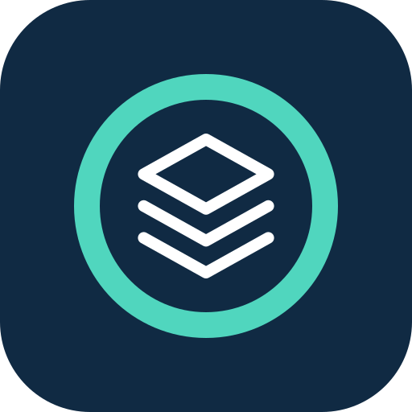

# obligacje.io

Explore bond data, issuer information, source documents and educational articles
with obligacje.io in a connected application. This package contains a workflow
skill, a remote MCP connection manifest, documentation and branding assets.
Version **0.1.6** updates the service description and tool-use guidance.

Data availability and catalog coverage can change. Use the scope, dates,
source citations and evidence gaps returned by the tools. A general service
description does not establish complete market coverage or the availability of
any particular instrument or feature.

## What you can ask

- Search, filter and compare bonds available in the catalog, inspect selected
  series and read source-backed issuer business profiles.
- Read available cached document summaries, typed facts and topic context with
  source documents, page citations, provenance and explicit evidence gaps.
- Read curated Polish/English knowledge articles. Educational topics do not
  establish the availability of corresponding instruments in the catalog.
- Ask one focused question through the obligacje.io assistant and follow
  validated links back to the website.

The 13 catalog, documentary review, knowledge and navigation tools are read-only.
`ask_assistant` creates a private conversation in the connected obligacje.io
account and consumes its existing assistant allowance. It is not read-only or
idempotent. Send only the question and necessary context; do not send the whole
external chat or automatically retry a timed-out assistant request.

Results are information and education, **not investment advice**. Assistant
answers may contain errors. Check cited original sources. Missing evidence is
not proof that a clause does not exist. Contract documents do not establish
current covenant compliance, completed payments, actual creation of security,
current fixings or the issuer's present financial condition. The integration
does not provide live prices, investment recommendations, trading or brokerage.

## Connection and access

The target endpoint is
[https://api.obligacje.io/mcp](https://api.obligacje.io/mcp), using Streamable HTTP.
Connection uses the user's obligacje.io account, browser sign-in and explicit
OAuth consent, subject to existing usage limits. Catalog reads and assistant
turns have separate scopes. Users
can revoke a connection in their obligacje.io account controls. Never paste
passwords, API keys, session cookies or access tokens into a chat or this package.

Read the current setup guide in [Polish](https://www.obligacje.io/integracje) or
[English](https://www.obligacje.io/en/integrations) for supported client flows.
Follow the host's connection flow and review the consent screen. Compatibility,
directory availability and account permissions depend on the host and version;
a package install alone does not verify a working connection.

For support, use the [support section](https://www.obligacje.io/en/integrations#support)
or email [support@obligacje.io](mailto:support@obligacje.io). Read the
[privacy policy](https://www.obligacje.io/en/privacy-policy) and
[terms of service](https://www.obligacje.io/en/terms). The connected application
also processes received information under its own terms and account settings.

## Package and review status

The [workflow skill](./skills/obligacje/SKILL.md) describes tool selection and
evidence handling. The [review cases](./review-cases.json) contain exactly five
positive and three negative **proposed cases**, all pending execution. They
describe expected outcomes, not observed results. The
[recording script](./recording-script.md) is also unexecuted; no demo recording
URL or reviewer credentials are bundled. These proposed cases are reusable
checks for this package revision; historical checks and the live listing do not
establish their execution for a new revision.

The [changelog](./CHANGELOG.md) records package revisions. The [MIT license](./LICENSE)
covers only the distributed package files. It does not license the backend,
hosted API service, bond data or third-party source documents. The application
repository remains private; distributing this package does not expose its source.

## Packaging references

These public references explain the package formats and review requirements:

- [OpenAI plugin packaging](https://developers.openai.com/plugins/build/plugins)
  and [submission](https://developers.openai.com/plugins/deploy/submission).
- [Claude plugin structure](https://claude.com/docs/plugins/build),
  [pre-submission checklist](https://claude.com/docs/plugins/pre-submission-checklist),
  [platform support](https://claude.com/docs/plugins/platform-support) and
  [manifest reference](https://code.claude.com/docs/en/plugins/manifest-reference).
